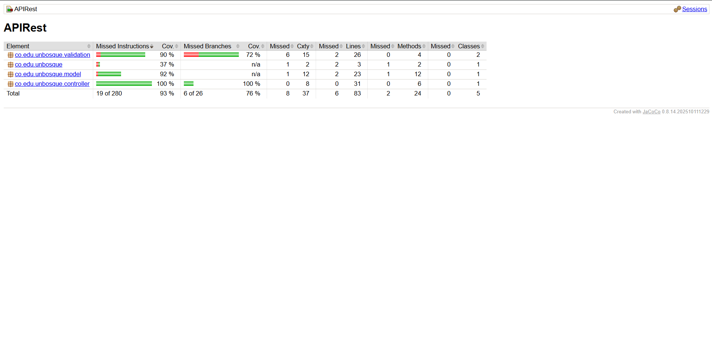

# Documento de Justificación de Pruebas: API de Avistamientos de Aves

**Asignatura:** Ingeniería de Software 2 (ISW-2) – Sesión 22  
**Autor:** Nicolás Espinosa  
**Fecha:** 21 de octubre de 2026  
**Repositorio:** `co.edu.unbosque` (API REST en Spring Boot + Gradle)

---

## 1. Qué cambió en el código (Refactorización para la Testeabilidad)

En la versión original del 29 de septiembre, la API carecía de reglas de negocio aisladas y el controlador (`AvistamientoController`) se limitaba a recibir objetos HTTP y delegarlos directamente en `AvistamientoRepository`. Si hubiéramos programado las validaciones dentro de los métodos `@PostMapping` y `@PutMapping` del controlador y consultado la fecha con `LocalDate.now()`, el código habría quedado fuertemente acoplado al transporte HTTP y al reloj del sistema operativo.

Para hacer la API verdaderamente testeable, aplicamos separación de responsabilidades e inversión de dependencias mediante tres cambios estructurales:

1. **Extracción de la lógica de dominio a `ValidadorDeAvistamiento`:**  
   Se creó la clase `co.edu.unbosque.validation.ValidadorDeAvistamiento`, completamente independiente de las anotaciones web de Spring (`@RestController`, `ResponseEntity`, `HttpServletRequest`). Esto aumenta la **testeabilidad** porque permite instanciar el validador en memoria con un simple `new ValidadorDeAvistamiento(...)` y ejecutar decenas de **pruebas unitarias** en pocos milisegundos, sin levantar el contenedor de Spring Boot, el servidor embebido Tomcat ni el motor H2.
2. **Abstracción del tiempo mediante la interfaz `Reloj`:**  
   La regla exige validar que la fecha del avistamiento *"no sea posterior a hoy"*. Invocar `LocalDate.now()` directamente dentro del validador introduce una dependencia oculta y no determinista (el valor de `"hoy"` cambia cada 24 horas). Se extrajo la interfaz `Reloj` con el método `LocalDate hoy()`, implementada en producción por `RelojSistema`. Gracias a esta costura (*seam*), en las pruebas unitarias podemos inyectar un **doble de prueba (Stub)** con una fecha congelada, garantizando que las pruebas sobre la **frontera** temporal sean 100% deterministas y repetibles en cualquier fecha futura.
3. **Inyección por constructor en `AvistamientoController`:**  
   El controlador ahora recibe tanto `AvistamientoRepository` como `ValidadorDeAvistamiento` por constructor. Esto permite dos cosas:
    * En **pruebas unitarias**, inyectar un **Mock** del repositorio para verificar que el controlador no toque la capa de persistencia cuando los datos son inválidos.
    * En **pruebas de integración**, estandarizar la respuesta de error HTTP `400 Bad Request` devolviendo un cuerpo JSON estructurado (`{"error": "..."}`) que indica explícitamente qué campo violó la regla de negocio.

---

## 2. Tabla de casos de la Parte A (Partición de Equivalencia y Valores Límite)

Para diseñar los casos de prueba de `ValidadorDeAvistamientoTest` de manera sistemática —en lugar de adivinar entradas al azar—, se aplicaron las técnicas de **Partición de Equivalencia (PE)** y **Análisis de Valores Límite (AVL)**.

Para el análisis temporal se fijó el **Stub** del reloj en $\text{hoy} = \text{2026-10-21}$. Si definimos $L$ como la longitud de la cadena `especie` tras eliminar espacios laterales (`trim()`), la partición válida es $3 \le L \le 50$, las particiones inválidas son $L < 3$ y $L > 50$, y las **fronteras** exactas se ubican en $L \in \{2, 3, 50, 51\}$:

| # | Campo evaluado | Valor elegido en la prueba | Tipo de caso (Técnica) | Por qué ese valor y no otro (Justificación de Partición / Frontera) | Resultado esperado |
|---|---|---|---|---|---|
| 1 | Todos (`especie`, `fecha`, `lugar`, `observador`) | `"Turdus fuscater"` ($L=15$), `"2026-10-15"`, `"Humedal Córdoba"`, `"Nicolás Espinosa"` | **Representativo Válido (PE)** | `"Turdus fuscater"` ($L=15$) está lejos de las fronteras $3$ y $50$; `"2026-10-15"` es una fecha pasada válida. Representa a toda la partición de entradas válidas sin estar en el borde. | **Válido** (No lanza excepción) |
| 2 | `especie` | `"Ab"` ($L=2$) | **Valor Límite Inválido (AVL)** | Es el punto inmediatamente inferior a la frontera mínima ($3 - 1 = 2$). Se elige $2$ y no $1$ porque $2$ es el único valor capaz de detectar un defecto *off-by-one* donde el programador haya escrito `< 2` en vez de `< 3`. | **Inválido** (`IllegalArgumentException` indicando `especie`) |
| 3 | `especie` | `"Ave"` ($L=3$) | **Valor Límite Válido (AVL)** | Es la **frontera** inferior exacta ($L = 3$). Verifica que el extremo mínimo sea inclusivo. Si el código tuviera el error `length() <= 3`, un valor representativo como $15$ pasaría, pero $3$ lo detecta. | **Válido** (No lanza excepción) |
| 4 | `especie` | `"A".repeat(50)` ($L=50$) | **Valor Límite Válido (AVL)** | Es la **frontera** superior exacta ($L = 50$). Comprueba que el máximo permitido siga perteneciendo a la partición válida y no sea rechazado prematuramente por un `>= 50`. | **Válido** (No lanza excepción) |
| 5 | `especie` | `"A".repeat(51)` ($L=51$) | **Valor Límite Inválido (AVL)** | Es el primer valor entero en la partición inválida superior ($50 + 1 = 51$). Se elige $51$ y no $100$ porque $51$ prueba con precisión quirúrgica el corte exacto de la condición `> 50`. | **Inválido** (`IllegalArgumentException` indicando `especie`) |
| 6 | `fecha` | `"2026-10-21"` ($\text{fecha} = \text{hoy}$) | **Valor Límite Válido (AVL)** | La regla dice *"no es posterior a hoy"*. Por tanto, el día exacto de `hoy` en el `RelojFijoStub` (`2026-10-21`) es la **frontera** superior válida del dominio temporal. | **Válido** (No lanza excepción) |
| 7 | `fecha` | `"2026-10-22"` ($\text{fecha} = \text{hoy} + 1\text{ día}$) | **Valor Límite Inválido (AVL)** | En resolución de días (`LocalDate`), `"2026-10-22"` (mañana) es el incremento mínimo posible más allá de la frontera válida (`isAfter(hoy)`). Elegir mañana en vez del año 2030 garantiza probar el borde exacto. | **Inválido** (`IllegalArgumentException` indicando `fecha` posterior a hoy) |
| 8 | `fecha` | `"21/10/2026"` | **Partición Inválida de Formato (PE)** | Representante de la partición de cadenas que representan fechas reales pero violan la gramática ISO `AAAA-MM-DD` exigida por la regla. | **Inválido** (`IllegalArgumentException` indicando formato `AAAA-MM-DD`) |
| 9 | `lugar` | `"   "` (solo espacios) | **Partición Inválida / Frontera de blancos (PE)** | Verifica que una cadena no vacía en memoria (`length() == 3`), pero vacía semánticamente tras `trim()`, caiga en la partición inválida. | **Inválido** (`IllegalArgumentException` indicando `lugar`) |
| 10 | `observador` | `""` ($L=0$) | **Valor Límite Inválido (AVL)** | Longitud cero ($L=0$) en la frontera inferior absoluta de cadenas para el campo obligatorio `observador`. | **Inválido** (`IllegalArgumentException` indicando `observador`) |

---

## 3. Por qué cada nivel (Pruebas Unitarias vs. Pruebas de Integración)

Cada prueba fue ubicada deliberadamente en el **nivel** más bajo posible capaz de detectar el defecto objetivo:

1. **Por qué `validar_cuandoEspecieTiene50Caracteres_esValidoEnLimiteSuperiorExacto` y `validar_cuandoFechaEsMananaSegunRelojStub_lanzaExcepcionPorFechaFutura` son Pruebas Unitarias:**  
   Ambas verifican lógica puramente algorítmica y de fronteras dentro de un único método en memoria (`ValidadorDeAvistamiento.validar`). Si las hubiéramos escrito como pruebas de integración (`@SpringBootTest`), cada caso de borde tendría que pasar por serialización JSON, el `DispatcherServlet` y el contexto de Spring, multiplicando el tiempo de ejecución sin aportar valor adicional sobre la regla booleana.
2. **Por qué `POST_cuandoAvistamientoEsValido_responde201YPersisteParaPosteriorGET` y `DELETE_eliminar_cuandoExiste_respondeExitoYPosteriorGETDevuelve404` son Pruebas de Integración:**  
   Su objetivo es verificar el contrato HTTP de extremo a extremo y el efecto colateral sobre la base de datos H2 real. Una prueba unitaria con repositorio simulado no puede garantizar que después de un `DELETE` el registro desaparezca realmente de la tabla SQL ni que un `GET` subsecuente devuelva `404 Not Found`.
3. **¿Qué detecta la prueba de integración del `POST` que la unitaria del validador NO puede detectar?**  
   La prueba unitaria del validador únicamente comprueba que el método `validar(avistamiento)` no lance excepciones ante un objeto Java válido. En cambio, la prueba de integración del `POST` detecta defectos en la **integración de capas**:
    * Fallos de deserialización de Jackson al convertir el texto JSON del cuerpo HTTP en una instancia de `Avistamiento` (por ejemplo, si los nombres de las propiedades JSON no coinciden con los *setters* o falta el constructor vacío).
    * Errores en las anotaciones de Spring MVC (`@PostMapping`, `@RequestBody`) o en el código de estado devuelto (`201 Created` vs `200 OK`).
    * Errores de mapeo JPA/Hibernate (`@Entity`, `@Id`, `@GeneratedValue`) al ejecutar el `INSERT` real en H2.
    * Que el efecto de persistencia sea real y consultable en una segunda petición independiente (`GET /avistamientos/{id}`).

---

## 4. Los dobles de prueba utilizados

En la suite unitaria se emplearon dos **dobles de prueba** con roles diferenciados:

1. **`RelojFijoStub` (implementación de la interfaz `Reloj`):**
    * **Tipo de doble:** **Stub**.
    * **Por qué ese tipo:** Un *Stub* provee respuestas preprogramadas a las llamadas que recibe el sistema bajo prueba (SUT) para controlar las entradas indirectas (en este caso, devuelve siempre `LocalDate.of(2026, 10, 21)` cuando el validador consulta `reloj.hoy()`). No necesitamos verificar cuántas veces se llamó al método `hoy()`, sino fijar el estado temporal.
    * **¿Qué habría pasado sin el doble?** Sin este *Stub*, la prueba del valor límite `"fecha de mañana"` (`2026-10-22`) dependería del reloj real de la máquina (`LocalDate.now()`). La prueba habría pasado hoy (21 de octubre de 2026), pero **mañana 22 de octubre pasaría a ser una prueba rota (*flaky / time-bomb test*)**, porque `"2026-10-22"` dejaría de estar en la partición futura y pasaría a ser `"hoy"`.
2. **`repoMock` (`Mockito.mock(AvistamientoRepository.class)`):**
    * **Tipo de doble:** **Mock**.
    * **Por qué ese tipo:** En la prueba `crearEnControlador_cuandoAvistamientoEsInvalido_noInvocaRepositorioSave`, el objetivo era realizar **verificación de comportamiento** sobre la interacción entre el controlador y el repositorio: comprobar mediante `verify(repoMock, never()).save(any())` que, cuando el validador rechaza un avistamiento, el controlador aborta la operación y jamás invoca la persistencia.
    * **¿Qué habría pasado sin el doble?** Sin el *Mock*, habríamos tenido que inyectar la base de datos H2 real para probar el controlador o habríamos sido incapaces de afirmar directamente en una prueba unitaria aislada que el método `save()` no fue invocado.

---

## 5. Lo que decidimos NO probar (Decisiones de alcance)

Escribir pruebas tiene un costo de desarrollo y mantenimiento; por ello, se tomó la decisión consciente de **no escribir** las siguientes pruebas:

1. **Pruebas unitarias directas para los *getters* y *setters* de la clase `Avistamiento`:**
    * **Razón:** Son métodos triviales de acceso a atributos sin lógica condicional ni transformaciones. Probarlos aisladamente no aporta detección de defectos de negocio y ya quedan ejercitados de forma transversal cuando Jackson serializa y deserializa el modelo durante las pruebas de integración.
2. **Pruebas para múltiples longitudes intermedias de `especie` (por ejemplo, probar longitudes 4, 10, 20, 30, 40 y 49):**
    * **Razón:** Según la teoría de **Partición de Equivalencia**, todos los valores dentro del intervalo $[4, 49]$ pertenecen a la misma clase de equivalencia válida y recorren exactamente la misma rama de código. Habiendo probado las **fronteras** ($2, 3, 50, 51$) y un valor representativo ($15$), agregar decenas de pruebas intermedias es redundante y no incrementa la capacidad de revelar fallos.
3. **Pruebas unitarias para el método `ApiRestApplication.main(String[] args)`:**
    * **Razón:** Ese método únicamente delega en `SpringApplication.run(...)`, el cual es código del framework Spring Boot ya probado por sus autores. Probarlo solo serviría para inflar artificialmente el porcentaje de cobertura sin validar ningún requisito funcional propio.

---

## 6. Lectura y análisis del reporte de cobertura (Parte C - JaCoCo)

Al ejecutar `.\gradlew.bat test jacocoTestReport`, la herramienta JaCoCo (v0.8.14) generó el reporte en `build/reports/jacoco/index.html`, arrojando un **93% de cobertura total de instrucciones** y un **76% de cobertura de ramas (branches)**:

### Resumen numérico del reporte JaCoCo

| Paquete (`Element`) | Cobertura de Instrucciones (`Cov.`) | Cobertura de Ramas (`Branches Cov.`) | Líneas sin cubrir / Totales (`Missed / Lines`) | Métodos sin cubrir / Totales (`Missed / Methods`) |
|---|---|---|---|---|
| `co.edu.unbosque.validation` | **90%** | **72%** | 2 de 26 | 0 de 4 |
| `co.edu.unbosque` | **37%** | n/a | 2 de 3 | 1 de 2 |
| `co.edu.unbosque.model` | **92%** | n/a | 2 de 23 | 1 de 12 |
| `co.edu.unbosque.controller` | **100%** | **100%** | 0 de 31 | 0 de 6 |
| **Total Global** | **93%** (19 of 280 missed) | **76%** (6 of 26 missed) | **6 de 83** | **2 de 24** |

### Identificación de líneas/ramas sin cubrir y conclusión crítica

Al inspeccionar el detalle del reporte de cobertura, identificamos exactamente qué representan las **6 líneas** y **6 ramas** no cubiertas y evaluamos si vale la pena escribir pruebas para ellas:

1. **Líneas y ramas sin cubrir en `co.edu.unbosque.validation` (2 líneas y 6 ramas faltantes):**
    * **Qué quedó sin cubrir:**
        * Las **2 líneas** sin cubrir corresponden al cuerpo del condicional defensivo `if (avistamiento == null) { throw new IllegalArgumentException(...); }` al inicio de `ValidadorDeAvistamiento.validar()`.
        * Las **6 ramas** corresponden a la rama `true` de esa guarda nula y a las sub-condiciones de evaluación por cortocircuito (`especie == null`, `fechaStr == null`, `lugar == null`, `observador == null`), ya que nuestras pruebas enviaron cadenas vacías (`""`), en blanco (`"   "`) o fuera de límite (`"Ab"`), pero no referencias `null` en cada campo individual.
    * **¿Hace falta escribir pruebas o no vale la pena?:** **No vale la pena.** El **criterio de cobertura** sirve para descubrir caminos lógicos importantes que olvidamos probar, no como una meta ciega del 100%. El comportamiento ante ausencia de datos en `lugar`, `observador`, `fecha` y `especie` ya está probado mediante cadenas vacías y espacios en blanco, y en la API real Jackson/Spring rechaza un cuerpo HTTP nulo antes de invocar al validador. Agregar 5 pruebas adicionales pasando `null` solo buscaría maquillar el indicador de ramas del 72% al 100% sin agregar valor real a la calidad del sistema.
2. **Líneas sin cubrir en `co.edu.unbosque` (`ApiRestApplication` — 2 de 3 líneas sin cubrir, 37%):**
    * **Qué quedó sin cubrir:** La llamada estática `SpringApplication.run(ApiRestApplication.class, args)` dentro de `main()`.
    * **Conclusión:** **No vale la pena probarlo**, pues `@SpringBootTest` ya verifica que el contexto de la aplicación levanta correctamente en las pruebas de integración.
3. **Líneas sin cubrir en `co.edu.unbosque.model` (`Avistamiento` — 2 de 23 líneas sin cubrir, 92%):**
    * **Qué quedó sin cubrir:** Un método accesorio del modelo que no es invocado durante el flujo de persistencia ni de serialización JSON.
    * **Conclusión:** **No hace falta una prueba**, ya que el modelo es una estructura de datos plana sin reglas de negocio. En cambio, el controlador (`AvistamientoController`), que orquesta los 5 endpoints y traduce las excepciones del validador a respuestas HTTP `200`, `201`, `204`, `400` y `404`, alcanzó el **100% de cobertura de líneas y de ramas**.